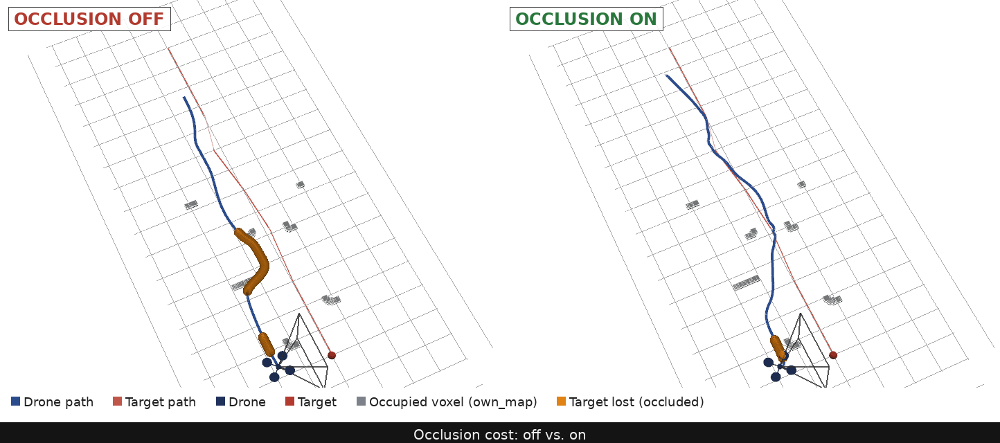
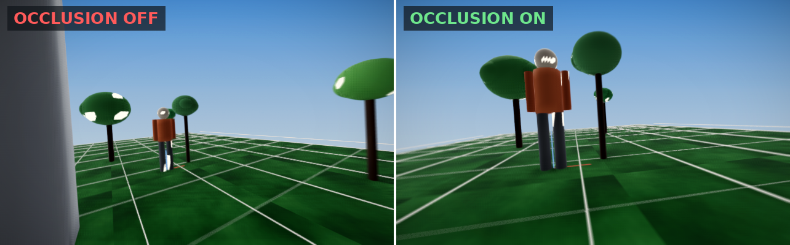
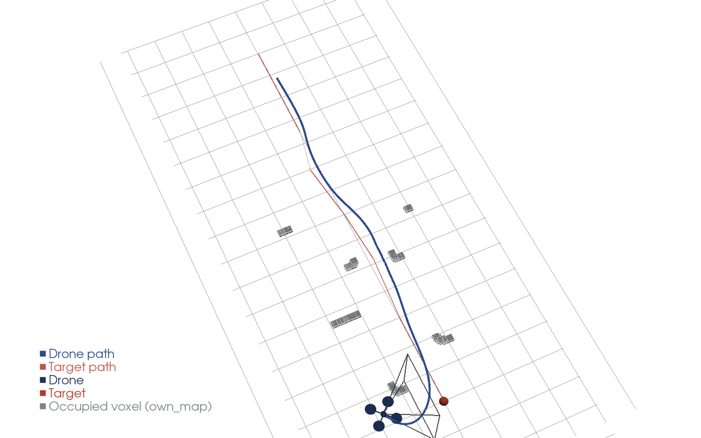

# Argus — Quadrotor Target-Tracking MPC

Model Predictive Control for a quadrotor tracking a circular trajectory with yaw locked toward an object at the centre. The controller is formulated as a Nonlinear MPC using [ACADOS](https://docs.acados.org/), which generates a C solver that is called from C++.

📄 **[Read the paper](paper/paper.pdf)** ([Markdown version](paper/paper.md)) — the occlusion-cost gradient-vanishing result, condensed below in [Paper summary](#paper-summary).



*Same forest, same leader — occlusion cost OFF (left) vs. ON (right): own_map's real occupied voxels, the camera frustum, the full drone/target paths, and the orange stretch marking where contact with the target was actually lost (occluded past threshold — shorter with the cost on). Generated with `scripts/render_technical_comparison.py --label-events` — see [TOOLING.md](TOOLING.md#technical-scene-view-validation).*

---

## Paper summary

A tight technical writeup of this project's main contribution lives in
[`paper/paper.pdf`](paper/paper.pdf) ([Markdown version](paper/paper.md)).
This section is a condensed version of it; the full derivations, gradients,
and appendix sweeps are in the paper itself.

Three extensions were made on top of the
[original Python/CasADi/IPOPT thesis controller](#related-work): porting it
to C++ solved in real time with ACADOS, with obstacles now sensed via an
onboard ESDF instead of known analytically; moving collision avoidance from
a soft cost to a slacked nonlinear constraint, which reaches its distance
target exactly instead of only approaching it asymptotically; and adding an
occlusion-aware cost, which turns out to have a structural flaw — its
gradient vanishes as the occluding obstacle approaches the target,
independent of weight.

The backend solves, every control tick:

```
min   Σ ‖r(x_k,u_k)‖²_W + ‖r_N(x_N)‖²_{W_N} + z_l·s + ½·Z_l·s²
s.t.  x_{k+1} = f(x_k,u_k)
      c_min ≤ c_k ≤ c_max,  -Ω_max ≤ Ω_B,k ≤ Ω_max
      d_lin(p_k) ≥ d_safe - s,  s ≥ 0
```

with `s` the collision slack. Each residual, briefly:

| Residual | Cost | Issue |
|---|---|---|
| Tracking | position-to-trailer-point (Baseline) or a decoupled distance/elevation/azimuth band (Band follower) | the Baseline's fixed point couples tracking error to collision/occlusion risk; the Band follower decouples it but then needs the FOV/occlusion costs to keep the target framed, which they only partially do |
| Field of view | squared softplus hinge on bearing | a shallow softplus leaves a curvature jump active near the cone edge, which the Gauss-Newton solver feels as chatter; also needs a separate centering term since the cone alone doesn't pull toward boresight |
| Collision | slacked constraint, `d_lin(p) ≥ d_safe - s` | as a plain squared-hinge cost (the earlier formulation) the gradient vanishes at the boundary, so no finite weight reaches `d_safe` exactly — the constraint's linear slack term fixes this |
| Occlusion | squared hinge on the ESDF, linearized at a point `(1-s)·drone + s·target` on the sightline | gradient is `-(1-s)·∇d` — vanishes as `s→1`, exactly when the obstruction sits near the target rather than the drone, the one case collision avoidance can't cover |

**Main result**, measured on `forest_clutter` (single run per row, not an
average — see the paper for the caveat):

| Configuration | Clearance (m) | Rate max (°/s) | Occlusion mean/max (%) | Reacq. |
|---|---|---|---|---|
| Baseline (fixed tracking, occlusion off) | 0.30 | 127.9 | 63.8 / 84.8 | 0 |
| Baseline, occlusion cost on | 0.35 | 86.4 | 62.6 / 82.1 | 1 |
| Band follower, occlusion on | 0.40 | 60.0 | 63.2 / 100.0 | 4 |
| Band follower + centering term | 0.38 | 61.8 | 65.8 / 100.0 | 1 |

Turning the occlusion cost on alone barely moves mean occlusion
(63.8% → 62.6%) — the vanishing-gradient problem showing up in practice.
The band follower trades a larger clearance for more lost-contact events;
the centering term recovers most, not all, of that reliability (the paper
walks through why).

Occlusion cost off vs. on, same scenario:


Rendered onboard camera footage, same tick, off vs. on (obstacle clearance
0.67 m → 1.47 m):



Third-person scene view of the same run — own_map's real occupied voxels,
the camera frustum, and the full drone/target trajectories, labeled
(`scripts/view_technical_scene.py`, see [TOOLING.md](TOOLING.md#technical-scene-view-validation)):



The full state/input definition, continuous-time dynamics, cost function,
and constraint table live in **[MODEL.md](MODEL.md)**, kept out of this
README to keep it skimmable.

---

## Architecture

```
config/quadrotor.yaml        ← single source of truth for all parameters

scripts/quadrotor_model.py   ← symbolic ODE (CasADi), reads yaml
scripts/generate_mpc.py      ← OCP formulation, writes:
        │
        ├─▶  c_generated_code/acados_solver_quadrotor.c/.h   (OCP solver)
        └─▶  c_generated_code/argus_params.h                 (C++ constants)
                 │
                 ▼  compile & link
        src/mpc_controller.cpp   ← C++ simulation loop
        src/plant_dynamics.cpp   ← second-order plant (intentionally different from MPC model)
```

The Python scripts are a **build tool**, not runtime code. Run them once to produce the C solver; the solver is then compiled into your C++ binary.

The plant simulator (`src/plant_dynamics.cpp`) is deliberately **not** the same model as the OCP predictor — the MPC uses a first-order lag (τ = 1/wn), while the plant runs the full second-order dynamics. This structural mismatch is the robustness test; it mirrors what will exist on hardware.

---

## Related work

This is a small NMPC project built as part of a larger thesis on drone target-tracking — not a research contribution. The idea of folding a camera/target-visibility term into the MPC cost (rather than treating perception and control as separate stages) follows the perception-aware MPC line of work:

> D. Falanga, P. Foehn, P. Lu, D. Scaramuzza, "PAMPC: Perception-Aware Model Predictive Control for Quadrotors," IEEE/RSJ International Conference on Intelligent Robots and Systems (IROS), 2018.

---

## Dependencies

| Dependency | Purpose |
|---|---|
| [ACADOS](https://github.com/acados/acados) | NLP solver and C code generation |
| [CasADi](https://web.casadi.org/) | Symbolic differentiation for dynamics and cost |
| Python 3 + `acados_template` | OCP formulation script |
| C++17 compiler | Application build |
| CMake ≥ 3.16 | Build system |

Assumed install path: `~/acados`. Adjust `ACADOS_ROOT` in `CMakeLists.txt` if yours differs.

Install ACADOS itself following [its own install docs](https://docs.acados.org/installation/),
then the Python dependencies:

```bash
python3 -m venv .venv
source .venv/bin/activate
cd to argus folder
pip install -r requirements.txt
pip install -e $HOME/acados/interfaces/acados_template   # tied to your acados checkout, not on PyPI
```

---

## How to run

```bash
./run.sh
```

That's it. The script runs the full pipeline in order: generate the C solver → CMake build → simulate → animate.

```
==> Generating C solver (scripts/generate_mpc.py)...
==> Configuring and building...
==> Running simulation...
==> Visualising (close the window to exit)...
```

**Skip steps you don't need:**

```bash
./run.sh --skip-gen          # model unchanged — skip solver regeneration
./run.sh --skip-build        # binary already up to date
./run.sh --skip-gen --skip-build   # run + plot only
```

> **WSL2 note:** `run.sh` sets `LD_LIBRARY_PATH` to include `~/acados/lib` automatically. You can also add it permanently to your `.bashrc`.

**Headless export** (no display needed):

```bash
python3 scripts/animate_xy.py --save-png docs/circle_tracking.png
python3 scripts/animate_xy.py --save-gif docs/circle_tracking.gif \
    --start-frame 20 --num-frames 160 --stride 2 --fps 15
```

`--start-frame`/`--num-frames`/`--stride` trim and downsample the run (skip
the initial transient, keep the GIF file size reasonable); `--frame` picks
which single frame `--save-png` renders.

---

## Other demos

Beyond the circle-tracking demo above (`./run.sh` / `./build/argus_mpc`), two
more executables build on the same `QuadrotorMpc` solver:

| Demo | What it adds | Log | Scenario |
|---|---|---|---|
| `./build/argus_mpc` | baseline circle-tracking | `logs/trajectory.csv` | `config/target.yaml`'s circle/static target |
| `./build/trailer_mpc_demo [line\|circle\|zigzag] [t_end_s]` | `argus_follower::TrailerFollower` (hitch-lag leader-follower reference) drives the position reference instead of hover/orbit | `logs/trailer_mpc_trajectory.csv` | pick a leader motion pattern as the first CLI arg |
| `./build/online_mapping_demo [scenario.yaml]` | incremental ESDF mapping (`argus_esdf`/`argus_perception`) + the collision-avoidance constraint, both live | `logs/online_mapping_trajectory.csv` + `logs/online_mapping_esdf_snapshots.bin` + `logs/staleness_log.csv` | pick a scenario file as the first CLI arg (default `config/forest.yaml`) |

All three write the same canonical trajectory-CSV columns (full 12-state,
inputs, position reference, FOV target, solve status) — `online_mapping_demo`
adds one trailing `dist_obstacle` column — specifically so one dashboard
script works on any of them (see below). See `design_decisions.md` (local,
gitignored) for the reasoning behind the ESDF/MPC integration.

A scenario file (`config/forest.yaml`, `config/scenario_single_obstacle.yaml`)
bundles the ground-truth obstacle layout (`obstacles:` — circles/squares) and
the leader's path through it (`leader:` — waypoints + a piecewise-linear
`speed_profile`, so pacing and path shape are designed independently — see
`design_decisions.md`). Hand-authored, not procedural/Monte Carlo generated.

```bash
./build/trailer_mpc_demo zigzag 10.0
./build/online_mapping_demo                                    # config/forest.yaml
./build/online_mapping_demo config/scenario_single_obstacle.yaml
```

Full usage reference for the occlusion-cost implementation, the telemetry
dashboard, 3-D/ESDF animations, the offline 3-D viewer and camera-footage
renderer, run metrics, and config-variant A/B comparisons lives in
**[TOOLING.md](TOOLING.md)**.

---

## How to tune

Most tunable parameters live in **[`config/quadrotor.yaml`](config/quadrotor.yaml)**; the circle-trajectory shape is a separate file, **[`config/target.yaml`](config/target.yaml)**. See **[MODEL.md](MODEL.md#how-to-tune)** for the knob-by-section breakdown.

---

## Repository layout

```
argus/
├── config/
│   └── quadrotor.yaml              # all parameters — edit here
├── scripts/
│   ├── config.py                   # YAML loader (shared by Python scripts)
│   ├── quadrotor_model.py          # symbolic ODE (CasADi)
│   ├── generate_mpc.py             # OCP code generation
│   ├── animate_xy.py               # 3-D trajectory visualiser (frustum, bearing errors)
│   └── view_technical_scene.py     # white/grey voxel scene view (validation, see TOOLING.md)
├── src/
│   ├── mpc_controller.cpp          # C++ simulation loop
│   ├── plant_dynamics.hpp          # second-order plant interface
│   └── plant_dynamics.cpp          # second-order plant implementation
├── c_generated_code/               # auto-generated C solver — do not edit
├── paper/                          # paper.pdf / paper.md — the occlusion-cost result
├── CMakeLists.txt
├── run.sh                          # one-command pipeline: generate → build → run → plot
├── README.md                       # overview, paper summary, quickstart
├── MODEL.md                        # full state/ODE/cost/constraint spec
└── TOOLING.md                      # dashboards, 3-D viewer, config variants
```
