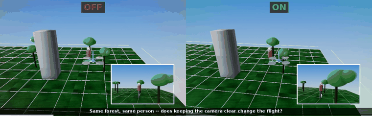

# Argus — Quadrotor Target-Tracking MPC

Model Predictive Control for a quadrotor tracking a circular trajectory with yaw locked toward an object at the centre. The controller is formulated as a Nonlinear MPC using [ACADOS](https://docs.acados.org/), which generates a C solver that is called from C++.



*Same forest, same leader — occlusion cost OFF (left) vs. ON (right). Chase-cam view with the drone's onboard camera picture-in-picture. Generated with `scripts/render_occlusion_comparison.py --chase-cam` — see [Occlusion-aware cost](#occlusion-aware-cost) and [Offline 3-D viewer and camera footage](#offline-3-d-viewer-and-camera-footage-no-gazebo).*

---

## Model

### State and inputs

The quadrotor is modelled with 12 states and 4 inputs, using ZYX Euler angles.

**State** `x ∈ ℝ¹²`:

| Symbol | Indices | Unit | Description |
|---|---|---|---|
| x, y, z | 0–2 | m | position in world frame |
| vx, vy, vz | 3–5 | m/s | velocity in world frame |
| φ, θ, ψ | 6–8 | rad | roll, pitch, yaw (ZYX Euler) |
| p, q, r | 9–11 | rad/s | body-frame angular rates |

**Input** `u ∈ ℝ⁴`:

| Symbol | Index | Unit | Description |
|---|---|---|---|
| T | 0 | N | collective thrust (sum of all rotor forces) |
| p_cmd | 1 | rad/s | commanded roll rate |
| q_cmd | 2 | rad/s | commanded pitch rate |
| r_cmd | 3 | rad/s | commanded yaw rate |

The inputs are thrust and commanded body rates — matching the interface of a real flight controller such as PX4, which exposes a body-rate setpoint API. The dynamics of the inner rate controller are captured by a first-order lag on each body rate (time constants in `config/quadrotor.yaml` under `inner_loop`).

### Continuous-time ODE

**Position kinematics** — velocity integrates into position:
```
ẋ  = vx
ẏ  = vy
ż  = vz
```

**Translational dynamics** — thrust T acts along the body z-axis; rotating it to the world frame via R(φ,θ,ψ) gives the acceleration:
```
v̇x = T/m · (cos(ψ)·sin(θ)·cos(φ) + sin(ψ)·sin(φ))
v̇y = T/m · (sin(ψ)·sin(θ)·cos(φ) − cos(ψ)·sin(φ))
v̇z = T/m · cos(θ)·cos(φ) − g
```

The rotation is the ZYX convention: `R = Rz(ψ) · Ry(θ) · Rx(φ)`. When the drone is level (φ = θ = 0) this reduces to `v̇z = T/m − g`, so T = mg at hover.

**Euler angle kinematics** — relates body rates (p, q, r) to Euler rates:
```
φ̇ = p + sin(φ)·tan(θ)·q + cos(φ)·tan(θ)·r
θ̇ =     cos(φ)·q         − sin(φ)·r
ψ̇ =    (sin(φ)·q         + cos(φ)·r) / cos(θ)
```

This transformation has a kinematic singularity at θ = ±90°. The pitch constraint (±45°) in the OCP keeps the trajectory well away from it.

**Rotational dynamics** — first-order lag modelling the PX4 attitude-rate controller:
```
ṗ = (p_cmd − p) / τ_rp
q̇ = (q_cmd − q) / τ_rp
ṙ = (r_cmd − r) / τ_yaw
```

The actual PX4 rate controller is a second-order system (wn ≈ 25 rad/s for roll/pitch, wn ≈ 4 rad/s for yaw). A first-order lag with τ = 1/wn is a standard approximation that captures the dominant closed-loop pole. Since τ_rp = 0.04 s ≈ Ts, the inner-loop dynamics are not negligible and must be in the prediction model.

### Physical parameters

All parameters are in [`config/quadrotor.yaml`](config/quadrotor.yaml):

| Parameter | Default | Description |
|---|---|---|
| mass | 1.0 kg | total vehicle mass |
| gravity | 9.81 m/s² | gravitational acceleration |
| inner_loop.tau_rp | 0.04 s | roll/pitch rate time constant (1/wn, wn ≈ 25 rad/s) |
| inner_loop.tau_yaw | 0.25 s | yaw rate time constant (1/wn, wn ≈ 4 rad/s) |

Inertia (Ix, Iy, Iz) is no longer in the ODE — with body-rate inputs, inertia is implicitly captured by the inner-loop time constants.

---

## MPC formulation

### Cost function

ACADOS uses a **Nonlinear Least-Squares** cost:

```
min  Σ_{k=0}^{N-1} ‖h(x_k, u_k) − y_ref_k‖²_W  +  ‖h_e(x_N) − y_ref_N‖²_{W_e}
```

The output map `h` is built incrementally in `scripts/generate_mpc.py` from a
fixed core plus a handful of opt-in residual slots (`obstacle_avoidance.mode`,
`occlusion_avoidance.mode`, `trailer.distance_mode` in `config/quadrotor.yaml`
each add or remove one slot, so `ny`/`ny_e` are derived, not hardcoded). In the
**default config** — `trailer.distance_mode: fixed`, `obstacle_avoidance.mode:
slack`, `occlusion_avoidance.mode: disabled` — the map is:

```
h(x, u)  = [x, y, z, vx, vy, vz, φ, θ, p, q, r, r_fov, r_dist, r_elev, r_azimuth, T, p_cmd, q_cmd, r_cmd]   (ny = 19)
h_e(x)   = [x, y, z, vx, vy, vz, φ, θ, p, q, r, r_fov, r_dist, r_elev, r_azimuth]                            (ny_e = 15)
```

Notes on what changed from a plain position/attitude tracker:

- **Yaw (ψ) has no dedicated cost term at all.** It's free to settle anywhere
  the FOV-cone residual `r_fov` below allows — there's no term pulling it
  toward a specific heading, only the soft constraint that the leader stay in
  frame.
- **Realized body rates `p, q, r`** (weight 5/5/5) are penalised separately
  from the **rate *commands*** `p_cmd, q_cmd, r_cmd` (weight 1/1/1,
  end of the vector) — the plant is a second-order lag on top of the MPC's
  own first-order prediction model, so a smooth commanded-rate sequence
  doesn't by itself guarantee a smooth realized rate; both are penalised.
- `r_fov = softplus(cos(α_FOV) − cos(γ))` — zero inside the camera's FOV
  cone, grows smoothly outside it (γ = bearing angle to the leader).
- `r_dist = ‖p_drone,xy − p_leader,xy‖ − D_DESIRED` — ground-plane-only
  standoff-distance residual (not 3-D range; see `r_elev` below for why).
  `trailer.distance_mode: band` replaces this with two independent squared
  hinges (`r_dist_min`, `r_dist_max`), a dead zone over `[D_MIN, D_MAX]` with
  zero cost anywhere inside it — `ny`/`ny_e` each grow by 1 in this mode.
- `r_elev = (z_drone − z_leader) − horiz_dist·tan(target_bearing_deg)` —
  dedicated look-down-angle residual, decoupled from `r_dist` so the solver
  can't trade standoff distance for elevation to satisfy one at the other's
  expense.
- `r_azimuth = 1 − cos(φ_rel − azimuth_target)` — dedicated "which side of
  the leader" residual (a position angle, not the drone's own yaw/heading).
- Collision avoidance is **not** a cost term in the default config — it's a
  slacked nonlinear constraint (see Constraints below). `obstacle_avoidance.mode:
  cost` swaps in a legacy squared-hinge `r_obs` residual instead (+1 to
  `ny`/`ny_e`), kept only for A/B comparison — see [Config variants](#config-variants-ab-comparisons).
- `occlusion_avoidance.mode: cost` adds an opt-in `r_occ` residual (+1 to
  `ny`/`ny_e`) — see [Occlusion-aware cost](#occlusion-aware-cost) below.

Stage weights `W` (diagonal), shipped default (`config/quadrotor.yaml`):

| Output | Weight | Rationale |
|---|---|---|
| x, y, z | 100 | tight position tracking (trailer-point reference) |
| vx, vy, vz | 10 | smooth velocity profile |
| φ, θ | 5 | keep drone roughly level |
| p, q, r (realized rates) | 5 | damp oscillation the rate commands alone don't catch |
| r_fov | 300 | keep the leader inside the camera cone — high priority |
| r_dist, r_elev, r_azimuth | 0 | computed every solve, not penalised by default — x/y/z tracking is the sole position/azimuth authority; see the header comment in `config/quadrotor.yaml` |
| T, p_cmd, q_cmd, r_cmd | 0.1 / 1 / 1 / 1 | regularise inputs |

Terminal weights `W_e` roughly double the stage weights on position, velocity,
attitude, and rates to encourage stability at the end of the horizon
(`r_dist`/`r_elev`/`r_azimuth` stay at 0 for the same reason as above).

At each MPC step the reference `y_ref_k` (position, FOV target, azimuth
direction, ESDF linearization, …) is set at runtime from C++
(`acados_ocp_solver_set(..., "yref", ...)` / `"p"` for the runtime params) —
there is no fixed symbolic reference baked into the generated solver.

Ready-made `W_stage`/`W_terminal` pairs for every mode combination
(`obstacle_avoidance.mode`, `occlusion_avoidance.mode`,
`trailer.distance_mode`) live in [`config/variants.yaml`](config/variants.yaml).

### Constraints

| Quantity | Bound | Reason |
|---|---|---|
| T | [0, 2·T_hover] | thrust is one-directional; 2× hover as saturation limit |
| p_cmd, q_cmd | ±3.8397 rad/s (±220°/s) | PX4 stock `MC_ROLLRATE_MAX`/`MC_PITCHRATE_MAX` |
| r_cmd | ±3.4907 rad/s (±200°/s) | PX4 stock `MC_YAWRATE_MAX` |
| φ, θ | ±45° | PX4 stock `MPC_TILTMAX_AIR` |
| z | ≥ 0.3 m | hard ground-clearance floor — a true box constraint (`lbx`), not traded off against any cost term; clears rotor-downwash ground effect |
| `d_lin(p)` (ESDF, linearized) | ≥ `d_safe` (0.32 m default) | **collision avoidance** — a slacked nonlinear inequality constraint, not a cost residual: `obstacle_avoidance.mode: slack` (default). The slack carries an exact linear penalty (weight 1e4) so `d_safe` is enforced exactly wherever the problem is feasible, not just asymptotically approached the way a squared-hinge cost term would. `mode: cost` swaps in the legacy residual for A/B comparison only. |

Rate *commands* are bounded above; the *realized* rates `p, q, r` are only
shaped through the cost term above, not box-constrained.

### Horizon

| Setting | Value |
|---|---|
| N | 20 steps |
| Ts | 0.05 s |
| Look-ahead | 1.0 s |

### Solver

- **NLP solver:** SQP-RTI (one Real-Time Iteration per MPC cycle — suitable for embedded/fast execution)
- **QP solver:** PARTIAL_CONDENSING_HPIPM
- **Integrator:** ERK (explicit Runge-Kutta), RK4, 1 step per interval
- **Hessian:** Gauss-Newton approximation

---

## Architecture

```
config/quadrotor.yaml        ← single source of truth for all parameters

scripts/quadrotor_model.py   ← symbolic ODE (CasADi), reads yaml
scripts/generate_mpc.py      ← OCP formulation, writes:
        │
        ├─▶  c_generated_code/acados_solver_quadrotor.c/.h   (OCP solver)
        └─▶  c_generated_code/argus_params.h                 (C++ constants)
                 │
                 ▼  compile & link
        src/mpc_controller.cpp   ← C++ simulation loop
        src/plant_dynamics.cpp   ← second-order plant (intentionally different from MPC model)
```

The Python scripts are a **build tool**, not runtime code. Run them once to produce the C solver; the solver is then compiled into your C++ binary.

The plant simulator (`src/plant_dynamics.cpp`) is deliberately **not** the same model as the OCP predictor — the MPC uses a first-order lag (τ = 1/wn), while the plant runs the full second-order dynamics. This structural mismatch is the robustness test; it mirrors what will exist on hardware.

---

## Design decisions

### Python for formulation, C++ for execution

The model, cost function, and OCP are defined in Python using CasADi's symbolic math and the `acados_template` API. Python is the right tool here: CasADi lets you write the ODE and cost map as readable symbolic expressions, and ACADOS can automatically differentiate them to generate exact Jacobians and Hessians. Writing this in C++ directly would mean hand-coding derivatives and losing the safety net of symbolic verification.

Python is a **build-time** tool only. The output is generated C code that is compiled into the binary — at runtime there is no Python dependency and no interpreter overhead.

### Separate model and MPC scripts

`quadrotor_model.py` contains only the physics: state definitions, ODE, and no control policy. `generate_mpc.py` is the control design layer: cost weights, constraints, horizon, and solver settings.

The split exists because the model is shared by two independent consumers — the OCP solver (`generate_mpc`) and the plant integrator (`generate_sim`) — and coupling the dynamics to a specific controller would make it harder to swap formulations later (e.g. adding yaw pointing changes the cost but not the ODE). The physics and the control design have different rates of change and different reasons to be modified.

---

## Related work

This is a small NMPC project built as part of a larger thesis on drone target-tracking — not a research contribution. The idea of folding a camera/target-visibility term into the MPC cost (rather than treating perception and control as separate stages) follows the perception-aware MPC line of work:

> D. Falanga, P. Foehn, P. Lu, D. Scaramuzza, "PAMPC: Perception-Aware Model Predictive Control for Quadrotors," IEEE/RSJ International Conference on Intelligent Robots and Systems (IROS), 2018.

---

## Dependencies

| Dependency | Purpose |
|---|---|
| [ACADOS](https://github.com/acados/acados) | NLP solver and C code generation |
| [CasADi](https://web.casadi.org/) | Symbolic differentiation for dynamics and cost |
| Python 3 + `acados_template` | OCP formulation script |
| C++17 compiler | Application build |
| CMake ≥ 3.16 | Build system |

Assumed install path: `~/acados`. Adjust `ACADOS_ROOT` in `CMakeLists.txt` if yours differs.

Install ACADOS itself following [its own install docs](https://docs.acados.org/installation/),
then the Python dependencies:

```bash
pip install -r requirements.txt
pip install -e $HOME/acados/interfaces/acados_template   # tied to your acados checkout, not on PyPI
```

---

## How to run

```bash
./run.sh
```

That's it. The script runs the full pipeline in order: generate the C solver → CMake build → simulate → animate.

```
==> Generating C solver (scripts/generate_mpc.py)...
==> Configuring and building...
==> Running simulation...
==> Visualising (close the window to exit)...
```

**Skip steps you don't need:**

```bash
./run.sh --skip-gen          # model unchanged — skip solver regeneration
./run.sh --skip-build        # binary already up to date
./run.sh --skip-gen --skip-build   # run + plot only
```

> **WSL2 note:** `run.sh` sets `LD_LIBRARY_PATH` to include `~/acados/lib` automatically. You can also add it permanently to your `.bashrc`.

**Headless export** (no display needed):

```bash
python3 scripts/animate_xy.py --save-png docs/circle_tracking.png
python3 scripts/animate_xy.py --save-gif docs/circle_tracking.gif \
    --start-frame 20 --num-frames 160 --stride 2 --fps 15
```

`--start-frame`/`--num-frames`/`--stride` trim and downsample the run (skip
the initial transient, keep the GIF file size reasonable); `--frame` picks
which single frame `--save-png` renders.

---

## Other demos

Beyond the circle-tracking demo above (`./run.sh` / `./build/argus_mpc`), two
more executables build on the same `QuadrotorMpc` solver:

| Demo | What it adds | Log | Scenario |
|---|---|---|---|
| `./build/argus_mpc` | baseline circle-tracking | `logs/trajectory.csv` | `config/target.yaml`'s circle/static target |
| `./build/trailer_mpc_demo [line\|circle\|zigzag] [t_end_s]` | `argus_follower::TrailerFollower` (hitch-lag leader-follower reference) drives the position reference instead of hover/orbit | `logs/trailer_mpc_trajectory.csv` | pick a leader motion pattern as the first CLI arg |
| `./build/online_mapping_demo [scenario.yaml]` | incremental ESDF mapping (`argus_esdf`/`argus_perception`) + the collision-avoidance constraint, both live | `logs/online_mapping_trajectory.csv` + `logs/online_mapping_esdf_snapshots.bin` + `logs/staleness_log.csv` | pick a scenario file as the first CLI arg (default `config/forest.yaml`) |

All three write the same canonical trajectory-CSV columns (full 12-state,
inputs, position reference, FOV target, solve status) — `online_mapping_demo`
adds one trailing `dist_obstacle` column — specifically so one dashboard
script works on any of them (see below). See `design_decisions.md` (local,
gitignored) for the reasoning behind the ESDF/MPC integration.

A scenario file (`config/forest.yaml`, `config/scenario_single_obstacle.yaml`)
bundles the ground-truth obstacle layout (`obstacles:` — circles/squares) and
the leader's path through it (`leader:` — waypoints + a piecewise-linear
`speed_profile`, so pacing and path shape are designed independently — see
`design_decisions.md`). Hand-authored, not procedural/Monte Carlo generated.

```bash
./build/trailer_mpc_demo zigzag 10.0
./build/online_mapping_demo                                    # config/forest.yaml
./build/online_mapping_demo config/scenario_single_obstacle.yaml
```

### Occlusion-aware cost

`online_mapping_demo` adds camera-awareness on top of the baseline cost: a
soft FOV-cone term keeps the leader inside the camera's view, a slacked
ESDF-based constraint keeps the drone clear of obstacles, and an **opt-in
occlusion-aware cost** (`occlusion_avoidance.mode: cost` in
`config/quadrotor.yaml`, default `disabled`) penalizes obstacles sitting on
the *sightline* between drone and leader — not just obstacles near the
drone itself, which is all collision avoidance can see.

It reuses the same onboard-built ESDF (`own_map`) as collision avoidance,
but marches it along the straight line from drone to target each stage to
find `s*` — how far along that line the worst point sits — and linearizes
the distance field there instead of at the drone's own position:

```
occ_p0 = (1-s*)·drone_p0 + s*·p_target
r_occ  = max(0, τ_occ − occ_lin(x))      # squared hinge, NLS auto-squares it
```

```yaml
occlusion_avoidance:
  mode: cost         # 'disabled' (default) or 'cost'
  tau_occ_m: 1.68     # activation margin -- derived from
                       # trailer.distance_to_target * tan(camera.fov_half_angle_deg)
```

**Known limitation:** `occ_p0` depends on the drone's own position with
weight `(1-s*)` only, so the gradient the solver actually acts on shrinks
toward zero as `s*→1` — exactly when the obstacle sits near the target and
far from the drone, the one case collision avoidance can't cover. The term
ends up strongest exactly where it duplicates collision avoidance (obstacle
near the drone, `s*→0`) and weakest exactly where it would be uniquely
useful. See `design_decisions.md` (local, gitignored) for the full
derivation and measurements, and the top-of-README GIF for an OFF/ON
comparison on a cluttered scenario.

### Telemetry dashboard

One figure, all state over time — works on any of the three logs above,
auto-adding an obstacle-distance panel when the log has one:

```bash
python3 scripts/plot_telemetry_dashboard.py --csv-path logs/trailer_mpc_trajectory.csv
python3 scripts/plot_telemetry_dashboard.py --csv-path logs/online_mapping_trajectory.csv --real-target-m 0.27
python3 scripts/plot_telemetry_dashboard.py --csv-path logs/trajectory.csv   # argus_mpc, the default --csv-path
```

Panels: XY path (with every obstacle outline, when present — pass
`--scenario-config` if plotting a non-default scenario file), yaw error
(MPC vs. bearing to the FOV target), velocity, attitude, body rates, XY
tracking error, distance to the FOV target, and (only when the log has a
`dist_obstacle` column) distance to the obstacle with the `d_safe` config
knob, the actual physical safety target (`--real-target-m`), and the run's
closest approach marked. Add `--save-png PATH` for a headless export
instead of an interactive window; `--keepaway-m` draws a constant
reference line on the distance-to-target panel (e.g.
`trailer.distance_to_target`).

### Animations

3-D trajectory view (`argus_mpc`/`trailer_mpc_demo`, already covered by
`--save-gif`/`--save-png` above):

```bash
python3 scripts/animate_xy.py --csv-path logs/trailer_mpc_trajectory.csv
```

Same 3-D view also works on `online_mapping_demo`'s log — no extra flags
needed, the ESDF snapshot log is auto-detected next to `--csv-path` (by
`online_mapping_demo`'s fixed `*_trajectory.csv`/`*_esdf_snapshots.bin`
naming) and draws two extra layers: every ground-truth obstacle as an
extruded shape (cosmetic height only — `own_map` is still a single
z-layer, no real height data to draw instead), and `own_map`'s ESDF as a
faded textured plane at z=0:

```bash
python3 scripts/animate_xy.py --csv-path logs/online_mapping_trajectory.csv
```

2-D ESDF map animation (`online_mapping_demo` only) — own_map's distance
field sweeping over time, every ground-truth obstacle shown in grey
(regardless of observed state), sensor-range circle, camera FOV wedge, and
all three paths (leader/follower/MPC actual) overlaid:

```bash
python3 argus_follower/scripts/plot_online_mapping.py
python3 argus_follower/scripts/plot_online_mapping.py --save-gif docs/online_mapping.gif --fps 10
```

### Offline 3-D viewer and camera footage (no Gazebo)

Real rendered 3-D playback and camera footage from a logged trajectory CSV
— ground (trees for circle obstacles, boxes for square ones; a low-poly
person for the leader; a real quadrotor mesh for the drone), and (for the
footage renderer) the drone's own forward-facing camera view at the
OAK-D-Lite's native 640x400 resolution, with real motion blur from
sub-frame temporal sampling, not an analytic estimate. Needs its own
dependencies (`scripts/requirements-viz.txt`, separate from
`requirements.txt` — only needed for these five scripts):

```bash
pip install -r scripts/requirements-viz.txt
```

Interactive/scrubbable 3-D scene (PyVista; `--off-screen --save-png` for a
headless single-frame export, no display needed). Two extra panels
auto-enable alongside the main 3-D view: own_map's live 2-D ESDF heatmap
(auto-detected next to `--csv-path`, silently skipped if there's no
snapshot log — e.g. `online_mapping_demo`'s other, non-mapping logs), and
the drone's own live camera footage (`--no-camera-panel` to drop it for a
faster interactive frame rate). Space toggles real-time play/pause once
the window is open; the slider scrubs manually at any time:

```bash
python3 scripts/view_scene3d.py --csv-path logs/online_mapping_trajectory.csv \
    --scenario-config config/forest.yaml --animate
```

Camera-footage frames (Open3D `OffscreenRenderer`, always headless) —
`--blur-subsamples 1` for a sharp baseline, higher for visible motion
blur (default 8), `--video PATH` to assemble an mp4 instead of a PNG
sequence, `--output-fps 30` to resample smoothly instead of one frame
per 20Hz control tick. Includes a telemetry HUD (`dist_obstacle`/slack/
solve time/occlusion%, red badge when close or heavily occluded) by
default — `--no-hud` for a clean shot:

```bash
python3 scripts/render_camera_footage.py --csv-path logs/online_mapping_trajectory.csv \
    --scenario-config config/forest.yaml --video logs/camera_footage/forest.mp4
```

This is a separate, visual-inspection tool — it doesn't feed back into
`run_scenario_suite.py`'s gates or replace `compute_metrics.py`'s
analytic blur-from-body-rate estimate, which stays the fast, suite-wide
metric.

Composite "hero" demo video — chase-cam 3-D view (drone mesh + leader +
trees) with the camera footage picture-in-picture, a light cinematic
grade applied (saturation/contrast/vignette) — the actual portfolio/CV
deliverable, not a diagnostic tool:

```bash
python3 scripts/render_hero_video.py --csv-path logs/online_mapping_trajectory.csv \
    --scenario-config config/forest.yaml --video logs/camera_footage/forest_hero.mp4
```

Occlusion OFF-vs-ON comparison video (`scripts/render_occlusion_comparison.py`)
— the tool behind the [Occlusion-aware cost](#occlusion-aware-cost) section
and the top-of-README GIF: two logged runs (same scenario, occlusion cost off
and on) side by side, either as full technical composites (3-D view + camera
footage + topdown panel for each) or, with `--chase-cam`, as a chase-cam view
with the onboard camera picture-in-picture, plus `--social` (big plain-
language stat readout instead of the technical HUD) and `--caption "..."`
(lower-third caption bar) for presentation-ready output:

```bash
python3 scripts/render_occlusion_comparison.py \
    --csv-off logs/band_final_off/trajectory.csv --csv-on logs/band_final_on/trajectory.csv \
    --chase-cam --social --caption "Occlusion cost: off vs. on" \
    --video logs/camera_footage/occlusion_comparison_chase.mp4
```

### Run metrics

`online_mapping_demo` only (needs its `clearance_true`/`occlusion_clearance`/
`solve_time_ms` log columns). Prints a summary table — collision safety
(measured against `--real-target-m`, the actual physical requirement, not
the inflated `d_safe` cost knob), tracking error, FOV bearing
(`pitch_bearing_deviation_from_design_deg` is the real pitch "error," since
0 is not the design target — see `config/quadrotor.yaml`'s
`trailer.target_bearing_deg`), occlusion, solver health, and smoothness —
plus a 7-panel figure:

```bash
./build/online_mapping_demo
python3 scripts/compute_metrics.py
python3 scripts/compute_metrics.py --save-png docs/metrics.png   # headless export
```

### Config variants (A/B comparisons)

Named config overlays in **[`config/variants.yaml`](config/variants.yaml)** (merged onto `config/quadrotor.yaml`, including `obstacle_avoidance.mode: slack|cost` — see `generate_mpc.py`'s `OBS_MODE`) let you A/B two formulations without hand-editing weights or checking out old commits — e.g. isolating whether a solve-time regression came from re-enabling trailer tracking or from the slacked collision constraint. `scripts/run_variant.py` applies one or more variants, rebuilds only if the resolved config actually changed, runs the scenario suite (loading cached per-scenario results when available — see `run_scenario_suite.py`'s `--no-cache`), restores the committed config afterward, and prints a pooled solve/onboard-time comparison table. Results are cached under `logs/variants/<name>/<hash>/` (config + metrics together, keyed by a hash of the resolved config and solver source).

```bash
python3 scripts/run_variant.py --list
python3 scripts/run_variant.py --variant trailer_on_slack_on --variant trailer_on_slack_off
python3 scripts/run_variant.py --variant trailer_on_slack_on --fresh   # ignore caches, fresh timing
```

---

## How to tune

Most tunable parameters live in **[`config/quadrotor.yaml`](config/quadrotor.yaml)**; the circle-trajectory shape is a separate file, **[`config/target.yaml`](config/target.yaml)**. Edit either, then re-run Step 1 to regenerate the solver.

```yaml
# config/quadrotor.yaml
model:               # physical properties (mass, inertia, gravity)
mpc:                 # N (horizon steps) and Ts (sample time)
constraints:         # thrust/rate/angle limits, ground-clearance floor
cost:                # W_stage and W_terminal diagonal weight vectors
trailer:             # standoff distance/band, look-down angle, azimuth smoothing
obstacle_avoidance:  # d_safe, slack weights, slack-vs-cost mode
occlusion_avoidance: # tau_occ, disabled-vs-cost mode

# config/target.yaml
circle:               # radius, altitude, lap period
```

After any change, re-run `./run.sh` (or `./run.sh --skip-gen` if only C++ source changed).

---

## Repository layout

```
argus/
├── config/
│   └── quadrotor.yaml              # all parameters — edit here
├── scripts/
│   ├── config.py                   # YAML loader (shared by Python scripts)
│   ├── quadrotor_model.py          # symbolic ODE (CasADi)
│   ├── generate_mpc.py             # OCP code generation
│   └── animate_xy.py               # 3-D trajectory visualiser (frustum, bearing errors)
├── src/
│   ├── mpc_controller.cpp          # C++ simulation loop
│   ├── plant_dynamics.hpp          # second-order plant interface
│   └── plant_dynamics.cpp          # second-order plant implementation
├── c_generated_code/               # auto-generated C solver — do not edit
├── CMakeLists.txt
├── run.sh                          # one-command pipeline: generate → build → run → plot
└── README.md
```
