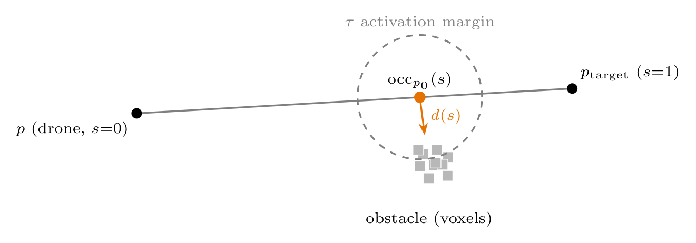
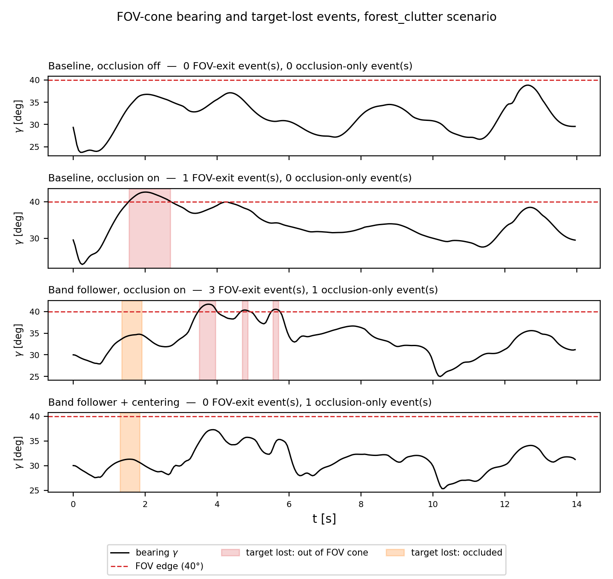
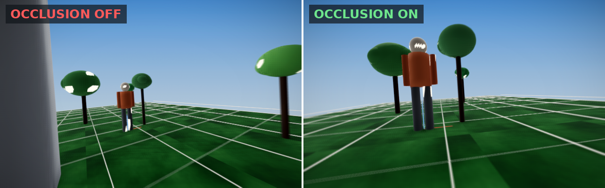
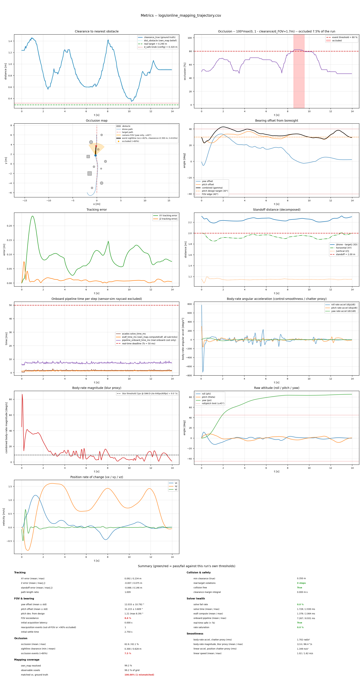
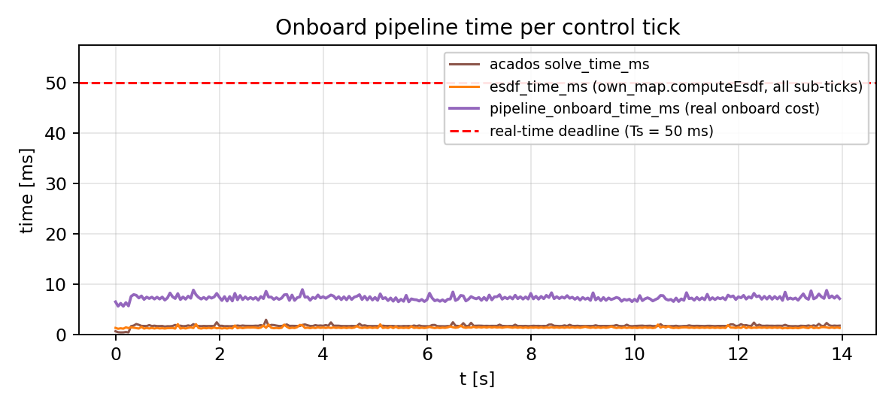
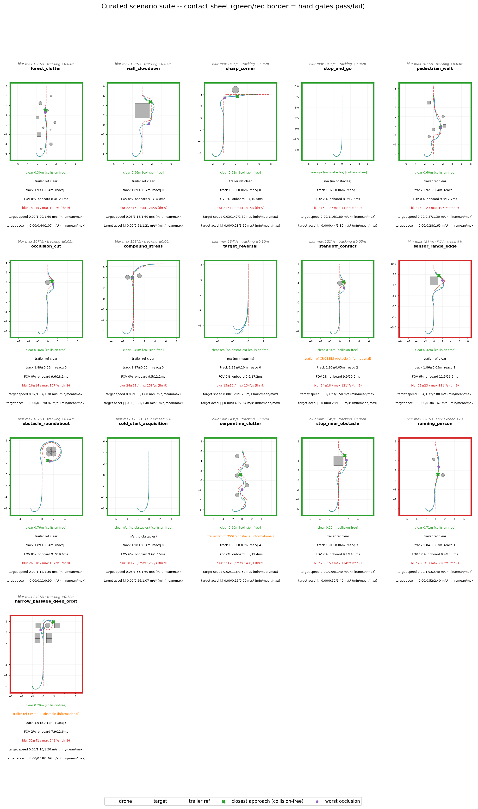

# ARGUS: Real-Time Perception-Aware MPC for Aerial Target Tracking with ESDF Obstacle Avoidance

**Bruno Pinto**

## Abstract

This paper reports a C++, real-time port of a perception-aware model predictive controller for aerial target tracking, originally implemented in Python with CasADi/IPOPT and known analytical obstacle shapes [1], together with four extensions to its cost and constraint formulation, each evaluated on a common scenario: tracking is moved from a fixed goal point to a band-and-centering formulation that trades reduced obstacle clearance pressure for more frequent loss of visual contact; the field-of-view cost's softplus sharpness is shown to trade a seven-fold drop in peak yaw jerk against command chatter; collision avoidance is moved from a soft cost term to a slacked nonlinear constraint; and an occlusion-aware cost term penalizes obstacles blocking the line of sight to the target, built from an ESDF rebuilt online from simulated onboard sensing instead of known shapes. The deepest result concerns this last term: a derivation showing that the occlusion cost, in its natural point-linearization form, has a gradient that structurally vanishes as the occluding obstacle approaches the target, independent of cost weight. Two candidate fixes, hard-min versus soft-min aggregation of multiple fixed sightline samples, and a steeper penalty function, are derived and tested, and both are shown to leave the underlying vanishing-gradient problem untouched. The root cause is identified as a geometric property of the point-interpolation parametrization itself, not a tuning or sampling artifact, pointing toward an angular or frustum-based formulation as the direction with different sensitivity near the target. The evaluation further splits a single merged reacquisition metric into its two distinct causes, cone exit versus occlusion, showing that the tracking formulation's centering fix resolves the former but leaves the latter, the occlusion cost's own weakness, untouched.

**Index Terms** — Trajectory Optimization, Model Predictive Control, Occlusion Avoidance, Aerial Target Tracking, Perception-Aware Planning

## 1. Introduction

Autonomous aerial tracking of a moving target through cluttered environments requires a controller that keeps the target in view, avoids collisions, and produces a trajectory the vehicle can actually fly. A first version of this controller was built in Python [1], using CasADi and IPOPT as the solver, with obstacles represented as known analytical shapes rather than sensed online.

This paper reports on four extensions made since, each measured on a common evaluation scenario (Section 5). I ported the controller to C++, solved in real time with acados, and replaced the known analytical obstacle shapes with an ESDF built from simulated onboard sensing. The tracking cost is reformulated from a fixed goal point to a band-and-centering scheme (Section 3.1); the field-of-view cost's softplus sharpness is retuned and its effect on command chatter measured (Section 3.2); collision avoidance is moved from a soft cost term to a slacked nonlinear constraint (Section 3.3); and an occlusion-aware cost term, absent from the original formulation, is added to penalize obstacles blocking the line of sight to the target (Section 3.4). The occlusion cost receives the deepest treatment of the four: its gradient is shown to vanish structurally in a specific, common geometric case, and two plausible fixes are tested and shown not to resolve it (Section 4). Section 7 states plainly what remains open.

## 2. System Architecture

The system is implemented in C++, generating the MPC solver through acados from a symbolic CasADi model (Figure 1). The target's trajectory is a known cubic spline, removing target-estimation error as a confound. Each occupancy voxel holds one of three states, free, occupied, or unknown: a tri-state classification, not a probabilistic occupancy grid, since the system does not model sensor or measurement uncertainty.

The sensor and the control loop run on independent clocks: the sensor sweeps at 60 Hz (16.6 ms), the MPC solves at 20 Hz (50 ms), three sweeps per control tick. The occupancy grid is updated every sweep, but the ESDF, the distance transform over that grid, is rebuilt only once per control tick: one build serves all three sweeps inside it. This is a compute-budget decision, since the transform is the expensive step and the MPC's costs only ever read the ESDF, never raw occupancy directly.

The cost is a nonlinear least-squares (NLS) problem: each residual $r_i$ is weighted and squared automatically, $\text{cost} = \sum_i W_i r_i^2$. acados approximates the cost Hessian with the Gauss-Newton approximation, $H \approx J^\top W J$, $J = \partial r/\partial p$, built only from each residual's first derivative; the residual's own second-derivative term is dropped entirely. The solver runs in real-time iteration (RTI) mode, one SQP step per control tick, no inner iterations, no line search: a poor local quadratic model is never corrected within the same tick.

The controller extends the perception-aware MPC line of work introduced by Falanga et al. [2], which couples a bearing-centering cost directly into the MPC rather than treating perception as a separate stage. The prior version of this controller [1] already builds on this approach with its own field-of-view cost (Section 3); the extensions here, collision avoidance as a constraint and an occlusion-aware cost, go beyond both.

## 3. MPC Formulation

The back-end solves, at every control tick,

$$
\begin{aligned}
\min_{x,u,s}\;\; & \sum_{k=0}^{N-1} \lVert r(x_k,u_k) \rVert_{W}^2 + \lVert r_N(x_N) \rVert_{W_N}^2 + z_l s + \tfrac{1}{2} Z_l s^2 \\
\text{s.t.}\;\; & x_{k+1} = f(x_k, u_k), \\
& c_{\min} \le c_k \le c_{\max}, \;\; -\Omega_{\max} \le \Omega_{B,k} \le \Omega_{\max}, \\
& d_{\text{lin}}(p_k) \ge d_{\text{safe}} - s, \;\; s \ge 0,
\end{aligned}
$$

where $r$ stacks the per-term residuals defined below, $f$ is the quadrotor dynamics, $c$ is normalized thrust, $\Omega_B$ is body rate, and $s$ is the collision slack (Section 3.3). Each subsection gives one residual's cost, its gradient with respect to the drone's own position, and the issue found with it.

### 3.1 Tracking Cost

Two different mechanisms carry tracking authority, used in different rows of Table II, not one combined formula. The *Baseline* rows pursue a single goal point directly: the follower computes it using a trailer analogy, pulled behind the leader at a fixed bearing and distance, turning with the leader the way a towed trailer follows a car around a corner, and the drone's $(x,y,z)$ position is driven toward that point by a plain quadratic residual, $r_{\text{pos}} = p - p_{\text{ref}}$.

The *Band follower* rows zero that position weight (Table I) and replace it with three residuals computed from the drone's position relative to the leader directly, not the trailer point. A distance band leaves the drone free to drift inside a margin at zero cost,

$$
r_{\text{dist}} = \max(0, d_{\min}-d) + \max(0, d-d_{\max}), \quad d = \lVert p - p_{\text{target}} \rVert.
$$

Vertical offset is pinned to a fixed look-down pitch angle $\theta_b$,

$$
r_{\text{elev}} = (z - z_{\text{target}}) - d_{\text{horiz}}\tan\theta_b,
$$

the relation that follows directly from requiring the camera to pitch down by exactly $\theta_b$ at horizontal range $d_{\text{horiz}}$. Which side of the leader the drone orbits on is held by a cosine residual rather than a raw angle difference, so it stays smooth across the $\pm180^\circ$ wrap,

$$
r_{\text{azimuth}} = 1-\cos(\varphi_{\text{rel}}-\varphi_{\text{target}}).
$$

*Issue:* the Baseline's single fixed point couples tracking error directly to collision and occlusion risk, since nothing in the cost distinguishes a tracking-error point that happens to sit near an obstacle from any other. The Band follower removes that coupling, but then relies on the field-of-view and occlusion terms (Sections 3.2–3.4) to keep the target framed, which they only partially do: Table II shows it trading a larger clearance for more lost-contact events, discussed in full in Section 5.

### 3.2 Field-of-View Cost

Let $V$ be the vector from drone to target and $\hat{u}_t$ the camera boresight unit vector. The target is inside the cone of half-angle $\alpha$ when

$$
s_{\text{fov}} = V^\top \hat{u}_t - \lVert V \rVert \cos \alpha \; \ge 0,
$$

penalized by a squared softplus hinge,

$$
r_{\text{fov}} = \frac{1}{\beta} \log\!\left(1 + e^{\beta s_{\text{fov}}}\right).
$$

![FOV cone geometry, reproduced from [1] (its own half-angle label, gamma, is this paper's alpha). s_fov >= 0 exactly when the bearing to the target, V, sits inside the cone.](figures/thesis_fov_cone.png)

*Issue:* squaring the raw hinge already makes it continuously differentiable at $s_{\text{fov}}=0$, but its second derivative still jumps from 0 to 2 there; since the solver's Gauss-Newton Hessian depends on curvature, not just gradient, a shallow $\beta$ leaves this jump active near the operating point and causes command chatter: sharpening $\beta$ from 5 to 20 drops peak yaw jerk from 42.16 to 6.34 rad/s$^2$ and eliminates all 40 command sign changes (Appendix, Table A2). Separately, this cost only keeps the target inside the cone; it does not pull it toward the center, which an added centering term, $r_{\text{center}} = 1-\cos\gamma$, was needed to fix once the tracking band stopped doing so implicitly.

### 3.3 Collision Avoidance

$d_{\text{safe}}$ sums the drone radius, one voxel width, and a staleness margin bounding how much the ESDF can change between linearizing it and acting on it, found empirically by logging the worst observed gap between a stale linearization and a fresh query (0.0649 m, rounded to 0.07 m):

$$
d_{\text{safe}} = \underbrace{0.15}_{\text{radius}} + \underbrace{0.05}_{\text{voxel}} + \underbrace{0.07}_{\text{staleness}} = 0.27 \text{ m.}
$$

Collision avoidance enters the MPC as a slacked constraint, $d_{\text{lin}}(p) \ge d_{\text{safe}} - s$, penalized $z_l s + \tfrac12 Z_l s^2$.

*Issue:* as a squared-hinge *cost* (the initial formulation), $r_{\text{obs}}=\max(0,d_{\text{safe}}-d_{\text{lin}})$, the gradient $2W(d_{\text{safe}}-d_{\text{lin}})$ vanishes at the boundary, so no finite weight achieves exact clearance (Appendix, Table A1). Reformulating as a constraint fixes this: the slack's linear term has gradient $z_l$, a constant that does not vanish at $s=0$, the classical exact-penalty property a quadratic cost never has.

### 3.4 Occlusion Cost

Occlusion is costed by linearizing the ESDF at a point along the drone-to-target sightline,

$$
\text{occ}_{p_0}(s) = (1-s)\, p + s\, p_{\text{target}}, \qquad r_{\text{occ}} = \max(0,\, \tau - d(s)),
$$

with $d(s)$ the ESDF linearized at $\text{occ}_{p_0}(s)$ and $\tau$ an activation margin.

Differentiating with respect to the drone's own position $p$,

$$
\frac{\partial\, r_{\text{occ}}}{\partial p} = -(1-s)\,\nabla d.
$$

*Issue:* this gradient vanishes structurally as $s\to1$ (obstruction near the target), independent of weight. Section 4 derives why and tests two fixes, neither of which resolves it.

### 3.5 Weights

Table I summarizes the operating weights and their source. None were derived analytically; each was set by a sweep (Section 3.2, 3.3, Appendix) or carried over unchanged once an earlier sweep had already validated it.

**Table I.** Operating weights and justification.

| Residual | Value | Source |
|---|---|---|
| $r_{\text{pos}}$ (Baseline) | 100 / 200 | stage/terminal, carried from initial tuning |
| $r_{\text{dist}}, r_{\text{elev}}, r_{\text{azimuth}}$ (Band) | $\approx$20–100 each | zero in Baseline rows, active only once $r_{\text{pos}}$ is zeroed |
| $r_{\text{fov}}$, $\beta$ | 100, 20 | $\beta$ swept (Table A2) |
| $r_{\text{occ}}$, $\tau$ | 20, 1.68 m | $\tau$ = FOV width at target range |
| collision $z_l$, $Z_l$ | 10000, 100 | $z_l$ large for exact penalty |
| rate regularization | 15 | carried from initial tuning |

## 4. Occlusion Cost: Structural Analysis

### 4.1 The Vanishing-Gradient Failure Mode

In the gradient above, $(1-s)$ is the entire sensitivity of the occlusion cost to the drone's own position. As the real obstruction approaches the target end of the sightline, $s\to1$, this factor, and the gradient the drone feels, go to zero regardless of weight. This is exactly the case collision avoidance (Section 3.3), which only sees obstacles near the drone, cannot substitute for: the occlusion term is weakest exactly where it is the only term that could help.

Figure 4 shows this geometry on a real evaluation-suite run: the sightline runs from the drone to the target inside the camera frustum, with own_map's occupied voxels standing in for the ESDF obstacle, occlusion cost off (left) and on (right), same tick.

### 4.2 Candidate Fix: Hard-Min vs. Soft-Min Combination

A natural fix costs several fixed sightline fractions instead of one adaptive point, so no sample's $(1-s)$ is itself a function of where the obstruction sits. The hard minimum, $d_{\min}(p)=\min_i d_i(p)$, is non-smooth where two samples tie, and the solver's Gauss-Newton Hessian jumps discretely across that tie, built only from whichever sample currently wins. A soft minimum,

$$
d_{\text{soft}}(p) = -\frac{1}{\beta}\log \sum_i e^{-\beta d_i(p)},
$$

blends all samples by softmax weight $w_i$, giving $\bar{g}=\sum_i w_i(1-s_i)\nabla d_i$, continuous everywhere, recovering the hard case as $\beta\to\infty$. Neither removes the underlying failure: if the obstruction genuinely sits near the target, whichever sample is nearest it still carries a small $(1-s)$ there.

Both were tested on the same scenario, varying only the combination rule (Appendix, Table A3): closest approach, field-of-view exceedance, and mean occlusion stayed within a narrow band of each other and of the adaptive single-point baseline. Only solver time moved consistently with $\beta$, rising with the curvature term the soft minimum adds near a tie, not with occlusion quality.

### 4.3 Candidate Fix: A Steeper Penalty Function

A second candidate reshapes the penalty, $r(d)=1/d-1/\tau$, an artificial-potential-field form growing faster as distance shrinks. This changes only the scalar multiplying the gradient direction; it has no effect on $(1-s)$. Multiplying zero by a steeper function of $d$ is still zero. It also reintroduces a singularity at $d=0$, the same class of problem as an unrelated earlier formula in this project whose derivative diverged at the system's own target operating point and caused a real collision (not detailed further, as it belongs to ongoing work).

### 4.4 The Underlying Geometric Cause

Neither candidate changes the parametrization. $\text{occ}_{p_0}(s)$ is a point on a segment between a moving end (the drone) and a fixed end (the target); a point near the fixed end barely moves when the moving end is perturbed, independent of sampling or aggregation. An obstacle occluding the sightline close to the target is, to first order, not something the drone's own position has leverage over.

**The lever-arm picture.** Put the target at one fixed end of the sightline and the drone at the other, moving end. At $s=0.85$, perturbing the drone's position by $\Delta_{\text{drone}}$ moves the linearization point $\text{occ}_{p_0}(s)$ by only $(1-s)\Delta_{\text{drone}} = 0.15\,\Delta_{\text{drone}}$: the same perturbation, 15% of the displacement at the point that matters. As $s\to1$ this ratio, and the gradient in the chain rule above, goes to zero. No choice of sample fraction, combination rule, or penalty shape changes this ratio, since it is a property of where the point sits on the segment, not of what is evaluated there. (The LaTeX/PDF version draws this directly as a figure; the geometry is described here in words since Markdown has no native diagramming.)

### 4.5 Implication for a Working Formulation

What retains sensitivity near the target is the sightline's angle, not a point's position on it: moving the drone swings the sightline's bearing substantially even when the obstruction sits near the target, the same lever-arm effect that makes a point there barely move. This points to an angular or frustum-volume formulation, not a reparametrization of the same point-on-segment idea. It is not built here; Section 6 states it as the next step.

## 5. Results

**Table II.** Measured on the `forest_clutter` evaluation scenario. Reacq. counts lost-contact events (leaving the FOV cone or exceeding 90% occlusion).

| Configuration | Clearance (m) | Rate max (deg/s) | Occlusion mean/max (%) | Reacq. |
|---|---|---|---|---|
| Baseline (fixed tracking, occlusion off) | 0.30 | 127.9 | 63.8 / 84.8 | 0 |
| Baseline, occlusion cost on | 0.35 | 86.4 | 62.6 / 82.1 | 1 |
| Band follower, occlusion on | 0.40 | 60.0 | 63.2 / 100.0 | 4 |
| Band follower + centering term | 0.38 | 61.8 | 65.8 / 100.0 | 1 |

Table II summarizes the configurations from Section 3. The scenario's obstacle layout and target trajectory are deterministic, so each row is a single run of its configuration, not an average over repeats; the numbers below should be read as one realization each, not as means with an implied variance. Turning the occlusion cost on alone barely moves mean occlusion (63.8% to 62.6%), consistent with Section 4.1: it only has real effect while the obstruction sits closer to the drone than to the target, and the gap is small enough on a single run that it should be treated as indicative, not conclusive, without repeated trials.

The band follower's reacquisition count (4 events, against 0 for the baseline) is the table's largest regression, and it traces directly to Section 3.1: the Baseline pins $(x,y,z)$ to the trailer point, so framing is fixed by construction, while the Band follower opens a dead zone on distance, elevation, and azimuth to buy the clearance gain above, and nothing then re-centers the target once the drone uses that freedom to dodge an obstacle, since the field-of-view cost (Section 3.2) only penalizes leaving the cone, not drifting toward its edge. The centering term, $r_{\text{center}}=1-\cos\gamma$, recovers most of this (4 to 1) by rewarding boresight alignment directly, but not all of it: it does nothing for the occlusion cost's own weakness (Section 4.1), and the lost-contact metric counts both failure modes as one event.

Figure 5 splits that merged count open. The Baseline's occlusion-off row never exceeds the cone; turning its occlusion cost on introduces one brief FOV excursion, not an occlusion-caused loss, at t≈2 s. The Band follower's four events are three FOV-cone exits plus one occlusion loss, confirming the mechanism above: the centering term's fix (4 to 1) is visible directly as the three red spans disappearing from the bottom panel, with the one orange occlusion span — the failure mode centering does not touch — left unchanged.

Figure 6 shows one of those three events directly: the same scenario tick, the Band follower's target has drifted past the cone edge while the centering variant, at that same instant, has already pulled it back inside.

No row resolves Section 4's structural problem; each trades a different combination of its symptoms.

Figure 7 shows the rendered view at the same tick as Figure 4: obstacle clearance rises from 0.67 m (off) to 1.47 m (on), the same effect Table II reports numerically, without the target leaving the frame in either case at this tick.

## 6. Limitations and Future Work

### 6.1 Toward an Angular/Frustum Formulation

The direction in Section 4.5, costing angular sensitivity or an approximate frustum-obstacle intersection instead of a linearized point, is not implemented here. It is scoped as the next step: a closed-form cost and gradient well-conditioned under the one-step SQP_RTI solver of Section 2, tested against the scenario used throughout Sections 4–5.

### 6.2 Remaining Approximation

Even a working angular or frustum formulation would still rely on a local point-or-sphere approximation of the obstacle's surface, from the ESDF's value and gradient at one query location, not a true volumetric intersection. That would require the live occupancy grid inside the differentiable symbolic model the solver is generated from, unavailable at code-generation time in this architecture; an acknowledged limitation of the direction above, not a problem it is expected to resolve.

A related tuning result is worth recording here since it generalizes beyond this one residual: pinning the elevation residual $r_{\text{elev}}$ with a nonzero weight bought a narrower altitude band only by raising vertical acceleration, not lowering it, across the evaluation suite, so a tighter constraint was not a smoother one.

### 6.3 Evaluation Scope

Every comparison in Section 5 and the Appendix is internal: configurations of this same controller against each other, on logged scenarios with no repeated trials (Section 5). There is no comparison against an external tracking method — a potential-field or sampling-based planner, or a learned policy — so the numbers here establish what the occlusion cost changes relative to this architecture's own baseline, not where this architecture sits relative to the field.

## 7. Conclusion

This paper reported four extensions to a perception-aware MPC for aerial target tracking, ported from Python to C++ with a real-time ESDF replacing known obstacle shapes: a band-and-centering tracking formulation, a retuned field-of-view cost, collision avoidance moved from a cost to a slacked constraint, and an occlusion-aware cost. The first three are measured improvements (Sections 3.1-3.3, 5): the band-and-centering fix eliminates all three of the evaluation run's FOV-cone-exit events, and sharpening the field-of-view penalty's softplus removes the command chatter a shallow setting leaves behind. The occlusion cost, in its point-linearized form, remains ineffective whenever the obstruction sits near the target rather than the drone, regardless of weight or sightline sampling. Two independent fixes were tested against this failure and both left it unchanged; the cause traces to the geometry of the point-on-segment parametrization itself, not to either candidate's own shortcomings. An angular or frustum-based reformulation, outlined in Section 6, has not yet been implemented or tested.

## Appendix

**Table A1.** Collision cost weight sweep, $d_{\text{safe}}=0.27$ m (Section 3.3).

| Weight | Closest approach (m) |
|---|---|
| 10 | 0.00 |
| 50 | 0.05 |
| 100 | 0.10 |
| 200 | 0.15 |
| 500 | 0.20 |

**Table A2.** FOV softplus $\beta$ sweep, yaw-correction scenario (Section 3.2).

| $\beta$ | FOV exceed. (s) | Peak yaw jerk (rad/s$^2$) | Sign changes |
|---|---|---|---|
| 5 | 0.30 | 42.16 | 40 |
| 20 | 0.30 | 6.34 | 0 |

**Table A3.** Occlusion combination rule comparison (Section 4.2).

| Rule | Clearance (m) | Occl. mean (%) | Solve time max (ms) |
|---|---|---|---|
| Adaptive (baseline) | 0.35 | 62.6 | — |
| Hard-min | 0.30 | 63.3 | 2.98 |
| Soft-min, $\beta=1$ | 0.30 | 63.0 | 2.75 |
| Soft-min, $\beta=5$ | 0.30 | 63.3 | 4.60 |
| Soft-min, $\beta=20$ | 0.30 | 63.3 | 5.30 |

### Evaluation Tooling

Two tools produced the numbers and tables above. A per-run metrics dashboard plots clearance, occlusion, bearing offset, tracking error, solver timing, and body-rate smoothness against time for one run, with a pass/fail summary against this run's own thresholds at the bottom:

One of its panels isolated directly: solve time, ESDF build time, and their sum against the 50 ms control-tick deadline (Section 2), same run as above. The solver and the ESDF rebuild together stay under 9 ms, well inside budget:

A 16-scenario evaluation suite (hand-authored obstacle layouts and target motion profiles, not procedurally generated) runs every configuration change through a common gate set. This is one suite overview grid, a top-down path thumbnail per scenario with a green or red border marking its gate result:

## References

[1] B. Pinto, "Autonomous Tracking in Cluttered Environments," Instituto Superior Técnico, Universidade de Lisboa, extended abstract.

[2] D. Falanga, P. Foehn, P. Lu, and D. Scaramuzza, "PAMPC: Perception-aware model predictive control for quadrotors," in *2018 IEEE/RSJ International Conference on Intelligent Robots and Systems (IROS)*, 2018, pp. 1-8.

[3] acados: fast and embedded solvers for nonlinear optimal control. https://docs.acados.org
